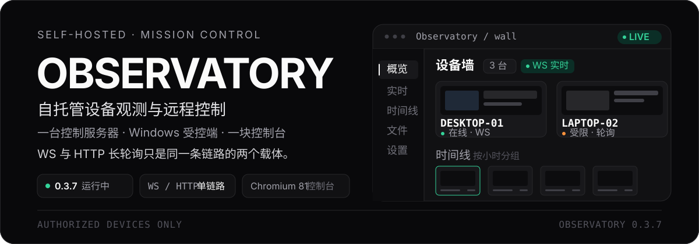
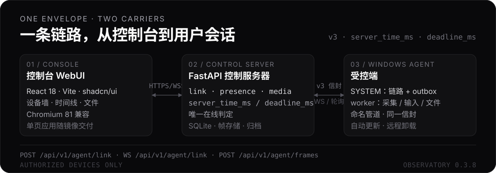

<p align="center">
  
</p>

<p align="center">
  <a href="VERSION"></a>
  
  
  
  
</p>

<h1 align="center">Observatory</h1>

<p align="center"><strong>把授权设备的画面、文件与操作，收进一块自托管控制台。</strong></p>

<p align="center">一台控制服务器 · Windows 受控端 · React 控制台</p>

> **授权使用**：本系统只用于你拥有、或已获得设备所有者明确书面授权的机器。详见 [docs/合规与授权.md](docs/合规与授权.md)。

## 这是什么

Observatory 是一套自托管的设备观测与远程管理系统。控制服务器负责设备入网、在线判定、画面与文件、控制命令；Windows 受控端在已登录的桌面会话中采集屏幕；控制台把设备墙、实时画面、时间线、文件和命令收在同一处。

它面向的是**自己拥有或明确获授权的 Windows 设备**：办公室工作站、测试机、展厅演示机。安装需要一次性令牌；实时控制是显式、带 TTL、可撤销的会话。

## 先看真实状态

- 当前版本：**0.3.7**，根目录 [`VERSION`](VERSION) 是唯一来源。
- 只读健康检查（部署后自检用，域名换成你自己的控制台域名）：

```bash
curl -s https://<console-host>/api/v1/health
# {"ok":true,"product":"Observatory","version":"0.3.7",...}
```

- 交付形态：GitHub Actions 构建前后端一体镜像 → GHCR → 服务器 `pull-and-restart.sh` 拉取切换。镜像按 commit sha 固定，健康检查失败自动切回旧镜像；日常上线不在服务器构建。

## 能做什么

| 能力 | 说明 |
| --- | --- |
| 设备墙与时间线 | 按在线状态、通道和最近上报聚合设备；画面按小时分组，点击进入该时段的帧列表 |
| 实时画面 | 会话内采集、变化检测、WebP 压缩与缩略图；受控端只在已登录桌面会话中采集 |
| 实时控制 | 经 WebSocket 载体中继鼠标/键盘；显式授权、TTL、撤销即时生效、全程审计 |
| 文件管理 | 驱动器、列目录、新建、改名、复制、移动、删除、搜索、按 1 MiB 分片读写（支持任意大小文件） |
| 自动更新 | 安装一次后上传新包即自动替换；sha256 + 预检 + 失败回滚，无 UAC |
| 远程卸载 | SYSTEM 自我清理，不弹 UAC；失败可观测并保持在线 |
| 一次性安装令牌 | 单次使用、TTL（控制台设置，默认 24 小时）、绑定首台设备、可撤销 |

## 为什么不是又一个远程桌面

- **一条链路，两种载体**：设备入网、心跳、命令、回执、事件只有一条逻辑链路；WebSocket 与 HTTP 长轮询只是同一条链路的两个载体。
- **一个在线判定**：`presence.py` 是唯一产出 `state` 与 `capabilities` 的地方；UI 和业务不直接读通道表。
- **一个时间源**：响应带 `server_time_ms`，需要预算的带 `deadline_ms`，设备时间命名 `device_time_ms`；不拿本机时钟做在线判断。
- **破坏性动作可观测**：重启、卸载、清空、删除、更新必须成功或给出可观测失败，不允许 fire-and-forget。
- **一次性安装令牌**：没有长期共享注册码；令牌单次使用、绑定首台设备，可撤销。
- **手表也能开**：控制台保留 Chromium 81 兼容产物，桌面、手机与手表 WebView 使用同一套界面。

<details>
<summary><strong>八条硬约束（0.3.0 规格，违反即返工）</strong></summary>

| # | 约束 |
| --- | --- |
| C1 | 设备入网/心跳/命令/回执/事件只有一条逻辑链路；WS 与 HTTP 长轮询只是两个载体 |
| C2 | 帧上传只有一条：`POST /api/v1/agent/frames`（原始字节），与载体无关 |
| C3 | 命令只有一个创建点、一个回执点；等待方作用域退出即清理，无全局 waiter 泄漏 |
| C4 | presence/capabilities 只有一个函数产出；UI/业务不得直接读通道表 |
| C5 | 时间只有一个来源：服务端时钟；响应带 `server_time_ms` / `deadline_ms` |
| C6 | 破坏性动作成功或可观测失败，禁止 fire-and-forget |
| C7 | 旧协议兼容代码只在兼容层；0.3.1 起该层已整体删除，新代码不得 import |
| C8 | 配置项要么生效要么不存在；每个 `Settings` 键都必须有消费者 |

</details>

## 工作方式

<p align="center">
  
</p>

控制台只和服务器说话；服务器只通过一条 link 链路和受控端说话。WS 与 HTTP 长轮询是同一信封协议的两种载体；画面统一走 `POST /api/v1/agent/frames`。受控端服务进程以 SYSTEM 持有链路与命令分发，用户会话 worker 只做采集、输入和文件，两者用同一份信封走命名管道。

<details>
<summary>协议 v3 信封</summary>

```json
{ "v": 3, "id": "<uuid4>", "t": "<type>", "ts_ms": 1730000000000, "body": { } }
```

- 端点：`POST /api/v1/agent/link`（上行批次 → 下行批次，可 hold ≤20s）、`WS /api/v1/agent/link`、`POST /api/v1/agent/frames`（`X-Frame-Id` 幂等）。
- 超时预算由服务端下发：deadline = min(类型上限, `max_command_deadline_ms`，默认 25s)，客户端 = deadline + 5s，响应带 `deadline_ms`。
- 错误统一 `{code, message, retryable, server_time_ms}`：AUTH / GONE / BAD_REQUEST / UNSUPPORTED / TIMEOUT / RATE / INTERNAL。

</details>

## 快速开始

### 本地开发

```bash
git clone https://github.com/H2O-ME/observatory.git
cd observatory

# 1. Python 依赖
python -m venv .venv
.venv/Scripts/pip install -r server/requirements.txt -r requirements-dev.txt   # Windows
# .venv/bin/pip install -r server/requirements.txt -r requirements-dev.txt     # Linux/macOS

# 2. 开发用服务端（弱口令，仅限本机）
cp server/.env.dev server/.env
.venv/Scripts/python -m uvicorn observatory.main:app --app-dir server --port 8443

# 3. 控制台（另开终端）
cd webui
corepack enable
pnpm install
pnpm dev
```

> `server/.env.dev` 只用于开发机，不要复制到生产。生产用 `deploy/setup.sh` 生成随机密钥。

### 质量门禁

```bash
.venv/Scripts/python -m pytest tests/ -q
cd webui && pnpm typecheck && pnpm build && pnpm check:legacy
```

受控端的解析、帧协议、传输阶梯与更新回滚可在任意平台测试；真实采集、输入、文件与卸载清理只在 Windows 上执行。CI 不跑测试，质量门禁在本地；CI 负责构建镜像、构建变更的受控端包并上线。

### 生产上线

```bash
# 首次引导：docker + compose、nginx + certbot、server/.env、compose
sudo REPO_URL=git@github.com:H2O-ME/observatory.git \
     CERTBOT_EMAIL=you@example.com \
     bash deploy/setup.sh

# 日常：push main 触发镜像构建与自动上线
git push

# 正式版本：bump VERSION → 打 tag → push；CI 额外打 vX.Y.Z 镜像别名
tools/release.sh
```

- 镜像在 GitHub Actions 中构建并推 GHCR；日常上线时服务器只 `docker compose pull && up -d`，零服务器构建。首次引导脚本 `setup.sh` 仍会在服务器构建一次作为兜底。
- `tools/release.sh` 要求工作树干净且位于 `main`；从 `SHENMI_GITHUB_TOKEN` 或 `.localdata/github-token` 读取推送令牌，不写入仓库。
- 受控端 exe 仅在 `agent/**` 或 `VERSION` 变更时由 Windows runner 构建，挂到固定 Release `latest-agent`。
- 失败自动回滚到旧镜像；数据库预部署快照留在数据卷。详见 [docs/发布与更新链路.md](docs/发布与更新链路.md)。

## 安全默认值

- 8443 默认只绑 `127.0.0.1`，由本机 nginx 反代；CDN 直连才显式设 `OBS_BIND_ADDR=0.0.0.0`。
- `OBS_TRUST_FORWARDED_FOR` 默认 false；只有可信反代拓扑才在 `.env` 显式打开。
- 容器非 root（`OBS_UID=10001`）、只读根文件系统、丢弃全部 capabilities、限制内存/CPU/PID。
- 所有密钥/口令只存 `server/.env`（chmod 600）或数据库哈希；安装包内没有长期共享注册码。
- 双域名分工：控制台只在 `CONSOLE_HOST`；`AGENT_HOST` 只提供安装脚本与 agent API。

## 兼容性与边界

- **受控端**：Windows x64；服务进程需要 SYSTEM，画面采集要求已登录的桌面会话。设备离线、无登录用户或采集被关闭时，时间线就是空的。
- **控制台**：React 18；桌面、手机与手表 WebView。Chromium 81 通过独立的 JS/CSS 兼容产物支持，现代浏览器使用原生构建。
- **服务端**：Python 3.12 + SQLite；单容器交付。启动时做版本化迁移，迁移前自动 `SQLite backup` 到 `data/backups/pre-migrate-v<from>-<timestamp>.db`。
- **边界**：只允许授权设备；不提供隐蔽监控或绕过授权的功能。实时控制只在 WebSocket 载体下可用，长轮询设备仍可截图、文件与命令；卸载、删除等操作都有审计与确认。
- **许可**：MIT；见 [docs/合规与授权.md](docs/合规与授权.md)。

## 项目结构

<details>
<summary>目录</summary>

```text
VERSION                       唯一版本来源
server/observatory/           控制服务器（Python 3.12）
server/observatory/templates/ 安装脚本模板（install.ps1 / install.cmd）
agent/observatory_agent/      受控端（Windows，PyInstaller onedir）
webui/src/                    控制台（React 18 + Vite + TypeScript）
deploy/                       compose / nginx / 部署、更新、备份、证书脚本
docs/                         规格、部署、接口、使用、打包、合规
usb-installer/                现场安装向导（不含硬编码凭据）
tests/                        unit / contract / acceptance / integration / perf
tools/                        版本工具与自检入口
```

</details>

## 文档

- [发布与更新链路（GHCR 拉取式交付）](docs/发布与更新链路.md)
- [部署](docs/部署.md) · [使用](docs/使用.md) · [接口](docs/接口.md)
- [0.3.1 修复规格](docs/0.3.1-修复规格.md) · [0.3.0 重构规格](docs/0.3.0-重构规格.md)
- [受控端打包](docs/受控端打包.md) · [合规与授权](docs/合规与授权.md)
- [项目通读报告（0.2.10 审计）](docs/项目通读报告.md)
